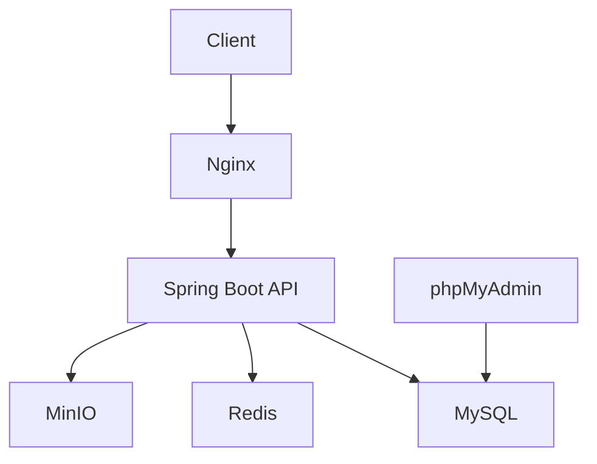

# Architecture

Modular monolith: Java 21, Spring Boot 4, Spring Data JPA, Spring Security/JWT, MySQL, Redis and S3-compatible MinIO storage. React/TypeScript and Tailwind storefront/admin are planned, not deployed by the current Compose file.

## Backend layout

`com.bunli.fashionecomapi` (proposed package): common/config, dto, exception, util; security; modules/auth, user, role, permission, navigation, category, collection, product, inventory, cart, wishlist, order, payment, shipment, address, coupon, banner, store, article, media, dashboard, report.

Each feature uses controller, service, repository, entity and DTO packages as needed. Controllers validate input; services enforce transactions and business rules; repositories access persistence. Do not expose entities or token hashes directly.

## Security

JWT access tokens; hashed refresh/reset tokens; active user/role/permission checks. module_type groups menus, module defines routes, module_detail defines authorities, role_permissions grants them. UI visibility is not authorization. Enforce ownership and permissions server-side. Use TLS, restricted storage credentials and secret management in production.
