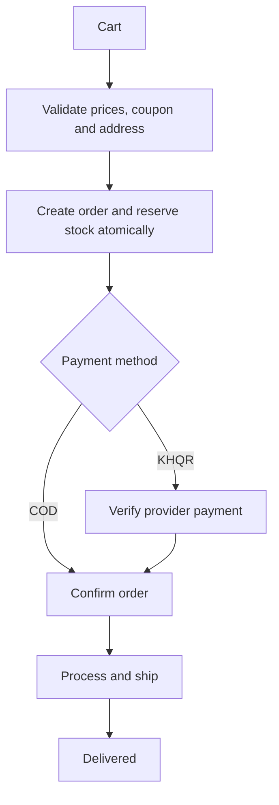

# Business Workflows

These are proposed service workflows, not verified implemented behavior.

## Authentication and permissions

Register → hash password → assign CUSTOMER role → login → issue access and refresh tokens → authorize requests using active roles and module details. Rotate/revoke refresh tokens; enforce expiry and one-time reset tokens.

## Catalog and shopping

Admin creates categories and navigation → uploads media → creates product and SKU variants → records opening stock → publishes active product. Customer browses, filters, selects variant, adds to cart or wishlist. Cart quantities must be positive; validate stock and current prices on the server.

## Checkout and payment

Use order snapshots and calculate subtotal minus discount plus shipping fee. Lock variant rows or use atomic updates to prevent overselling. For KHQR, verify amount, currency, reference and signature; process duplicate callbacks idempotently. COD payment is recorded when collected, not merely when confirmed. Expired or cancelled orders release reservations. Define stock deduction at shipment and log movements consistently. Refunds require provider integration and authorization.

Order statuses: PENDING, CONFIRMED, PROCESSING, SHIPPED, DELIVERED, CANCELLED. Payment statuses: PENDING, PAID, FAILED, REFUNDED, EXPIRED. Shipment statuses: PENDING, SHIPPED, DELIVERED, FAILED, RETURNED. Inventory movement types: IN, OUT, ADJUST, RETURN.

## Marketing

Validate coupon dates, minimum order, usage limit and discount cap; publish active banners and articles within applicable dates. Reports derive from transaction records, not soft-deleted catalog data.
